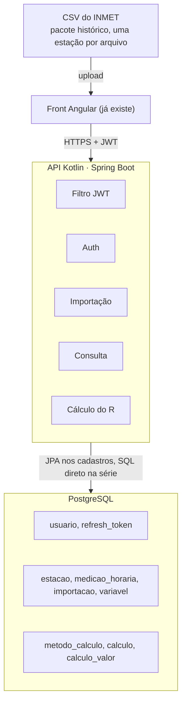
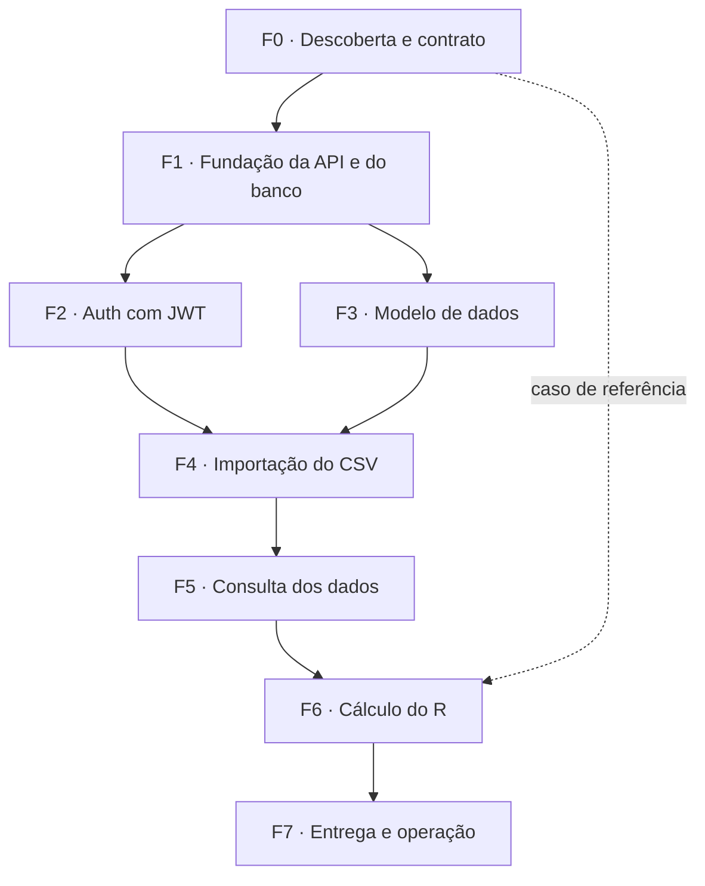

# Plano: API INMET e cálculo do fator R

- **Status:** 🔴 não iniciado (planejamento concluído; nenhuma linha de código escrita)
- **Criado:** 2026-10-05 · **Atualizado:** 2026-10-05
- **Fonte da verdade das tarefas:** este arquivo (`docs/plans/api-inmet-fator-r.md`).
- **Versão para leitura e comentário:** <https://claude.ai/code/artifact/2fb2ef72-0022-4b88-8e40-6e9bd6d0e966>

> **Para IAs/IDEs continuando este trabalho:** leia *Contexto*, *Premissas e perguntas em aberto*
> e *Decisões*. Pegue a primeira feature com dependência satisfeita, detalhe as tarefas dela
> (hoje só há títulos, a pedido do dono do projeto), execute, confira o **Pronto quando**, marque
> `- [x]` e acrescente ao *Log de decisões*. Mantenha o *Próximo passo* atualizado antes de parar.
> Este plano não contém código de propósito.

## Contexto

- **O quê:** estrutura própria para dados de estações meteorológicas do INMET. Uma API em Kotlin e
  um banco de dados recebem o CSV das estações, devolvem os dados por GET e guardam cálculos do
  fator R por estação e intervalo de datas. O front em Angular já existe.
- **Por quê / valor:** hoje o cálculo do R foi feito fora de um sistema. A aplicação precisa
  reproduzir esse cálculo sobre dados importados, com usuários e histórico de cálculos.
- **Escopo, entra:** API (controller, service, repository), banco, importação de CSV, consulta,
  auth com JWT, cálculo do R sobre precipitação, integração com o Angular existente.
- **Escopo, não entra no v1:** atualização automática a partir do INMET, upload de zip com várias
  estações em segundo plano, outras variáveis e métodos, perfis de parâmetros salvos, exportação
  de resultados, mapa, editor de fórmulas, estações convencionais.
- **Arquivos/áreas tocadas:** projeto novo (não existe repositório da API ainda). O repositório do
  front Angular não foi lido para este plano.

### Premissas e perguntas em aberto

Este plano foi escrito sem acesso à conversa em que o cálculo do R foi feito, ao CSV real e ao
código do front. As premissas abaixo sustentam o desenho; a Feature 0 confirma cada uma. Quem
decide é o dono do projeto, não a IA executora.

| # | Pergunta | Padrão assumido | Status |
|---|---|---|---|
| P1 | "R" é o fator de erosividade da chuva? Qual método o cálculo anterior usou? | Sim; equação mensal com coeficientes configuráveis | aberta |
| P2 | O cálculo anterior usou totais mensais ou eventos de chuva? O dado do INMET é horário e não traz intensidade em 30 minutos. | Totais mensais | aberta |
| P3 | De onde vem o CSV: pacote histórico anual, BDMEP ou tabela do site? | Pacote histórico anual de estação automática (dado horário) | aberta |
| P4 | Mês e ano fecham em UTC, como no arquivo, ou em hora local? | UTC, com o fuso como parâmetro do cálculo | aberta |
| P5 | Hora faltante conta como zero, invalida o mês ou bloqueia o cálculo? | Marca o mês e segue, com limite por parâmetro | aberta |
| P6 | Qualquer usuário importa CSV ou só administrador? | Só administrador | aberta |
| P7 | Cadastro aberto ou por convite? | Por convite em produção | aberta |
| P8 | Cada cálculo é privado ou visível a todos? | Privado | aberta |
| P9 | Onde a API e o banco vão rodar? | Sem padrão; decide a F7 | aberta |

Se P1 ou P2 tiverem resposta diferente do padrão, só a Feature 6 muda: o método de cálculo é uma
peça trocável e o resto do desenho não depende da fórmula.

## Visão geral



O dado bruto só entra pela importação. O cálculo lê esse dado e grava o resultado à parte, sem
alterá-lo. Dentro de cada módulo a dependência só desce: controller, service, repository.

## Decisões

| Decisão | Escolha | Por quê | Alternativa e quando rever |
|---|---|---|---|
| Banco | PostgreSQL | Usuário, cálculo e estação se relacionam; o CSV tem colunas fixas; o R nasce de somas por mês e ano | MongoDB: só se o dado deixar de ser tabular |
| Framework | Spring Boot com Kotlin | Segurança, validação, upload e acesso a dados já vêm prontos | Ktor: mais leve, mais montagem manual |
| Organização do código | Um pacote por módulo, com controller, service e repository dentro | O que muda junto fica junto | Pacote por camada: piora conforme o projeto cresce |
| Dado bruto | Tabela larga: uma linha por estação e hora, uma coluna por variável | Espelha o CSV; importar todas as colunas agora evita reimportar depois | Tabela longa (estação, variável, hora, valor): rever se entrar outra fonte de dados |
| Resultado dos cálculos | Cabeçalho do cálculo mais tabela longa de valores por etapa | Cada método gera etapas diferentes e o volume é pequeno | Colunas fixas por método: travam o próximo método |
| Cálculo configurável | Método em código, versionado, com parâmetros em JSON | Reproduzível e testável contra o cálculo já feito | Editor de fórmulas na tela: adiar |
| Processamento | Síncrono no v1; importação e cálculo já nascem como recursos com status | Um arquivo de estação-ano tem cerca de 8.760 linhas (24 × 365) | Fila em segundo plano: quando entrar zip com muitas estações |
| Auth | JWT emitido pela própria API, access curto e refresh com rotação | Controle total agora; a validação é a mesma de um provedor externo | Keycloak, Auth0 ou Supabase Auth: se o número de usuários crescer |
| Schema | Migrações versionadas com Flyway | Banco reproduzível em qualquer máquina | Geração automática pelo Hibernate: não usar |
| Contrato com o Angular | OpenAPI publicado pela API, cliente gerado | Os tipos do front não divergem da API | DTO escrito à mão nos dois lados |

Versões de Kotlin, Spring Boot e PostgreSQL não foram fixadas aqui. A F1 escolhe as estáveis do
dia e registra no Log de decisões.

## API em Kotlin

Seis módulos (auth, usuário, estação, medição, importação, cálculo) repetem as mesmas camadas.

| Camada | Faz | Não faz |
|---|---|---|
| Controller | Recebe HTTP, valida o DTO de entrada, chama um service, devolve DTO e código de status | Regra de negócio e acesso a banco |
| Service | Executa o caso de uso: orquestra, aplica a regra, abre a transação | Conhecer HTTP ou escrever SQL |
| Repository | Lê e grava. Spring Data JPA nos cadastros; SQL direto na carga em lote e nas agregações da série | Regra de negócio |
| Apoio | Leitor de CSV, métodos de cálculo, mapeadores entre DTO e entidade, erro global, configuração de segurança | Decidir o caso de uso |

Três regras valem para todos os módulos: a entidade nunca sai pelo controller, só DTO; todo erro
volta num formato único; toda rota fica sob `/api/v1`.

| Rota | Faz | Quem acessa |
|---|---|---|
| `POST /auth/cadastro` | Cria usuário | Público ou por convite (P7) |
| `POST /auth/login` | Devolve access e refresh token | Público |
| `POST /auth/refresh` | Troca o refresh por um par novo | Refresh válido |
| `POST /auth/logout` | Revoga o refresh | Autenticado |
| `GET /usuarios/eu` | Perfil do usuário atual | Autenticado |
| `POST /importacoes` | Recebe o CSV, processa e devolve o relatório | Admin (P6) |
| `GET /importacoes` e `/importacoes/{id}` | Histórico e relatório de cada carga | Admin |
| `GET /estacoes` | Lista com filtro por UF, nome e código | Autenticado |
| `GET /estacoes/{codigo}` | Metadados e cobertura dos dados | Autenticado |
| `GET /estacoes/{codigo}/medicoes` | Série por período, variável e granularidade (hora, dia, mês, ano) | Autenticado |
| `GET /estacoes/{codigo}/disponibilidade` | Horas presentes e faltantes por mês | Autenticado |
| `GET /metodos-calculo` | Métodos disponíveis e seus parâmetros | Autenticado |
| `POST /calculos` | Cria um cálculo para estação, período, método e parâmetros | Autenticado |
| `GET /calculos`, `/calculos/{id}`, `/calculos/{id}/valores` | Lista, resultado e valores por etapa | Dono do cálculo (P8) |
| `DELETE /calculos/{id}` | Remove o cálculo | Dono do cálculo |

O GET de medições exige início e fim. Na granularidade horária a janela tem limite; em dia, mês e
ano o banco agrega e devolve também quantas horas faltaram em cada intervalo.

## Importação do CSV do INMET

Um upload vira uma importação rastreável: o arquivo entra inteiro ou não entra, e reimportar não
duplica.

1. O controller recebe o arquivo (multipart), confere extensão e tamanho e entrega o conteúdo ao service.
2. O service calcula o hash do arquivo. Se ele já foi importado, devolve a importação anterior.
3. Cria o registro de importação com status "processando", usuário, nome do arquivo e hash.
4. O leitor lê o bloco de metadados do topo (região, UF, nome, código, latitude, longitude,
   altitude, data de fundação) e cria ou atualiza a estação pelo código.
5. Localiza a linha de títulos e casa cada coluna pelo nome normalizado, sem acento e sem
   diferença de caixa.
6. Converte cada linha: data e hora viram um instante em UTC; vírgula decimal vira número; valor
   faltante vira nulo.
7. Valida: linha com data inválida é rejeitada com o número da linha; valor impossível, como chuva
   negativa, vira nulo com aviso.
8. Grava em lotes, com inserção ou atualização pela chave estação mais instante, numa única
   transação. Na colisão, o arquivo mais recente vence.
9. Fecha a importação: status, linhas lidas, inseridas, atualizadas e rejeitadas, primeiro e
   último instante, primeiros erros.
10. Responde com o relatório da importação.

O leitor fica atrás de uma interface, um leitor por layout de arquivo. A tabela abaixo vem de
conhecimento geral do pacote histórico do INMET, **não** de um arquivo lido nesta sessão. A
Feature 0 confere cada linha no arquivo real antes de qualquer código.

| Ponto | O que esperar | Tratamento |
|---|---|---|
| Codificação | Latin-1, não UTF-8 | Ler como Latin-1; testar com nome de estação acentuado |
| Separador e decimal | Ponto e vírgula; vírgula decimal | Conversão própria de número |
| Cabeçalho | Linhas de metadados antes da tabela | Ler até achar a linha de títulos |
| Data e hora | O formato mudou entre anos: `2018-01-01` com `00:00`; `2019/01/01` com `0000 UTC` | Aceitar os dois |
| Fuso | Horário em UTC | Guardar em UTC; o fuso da agregação é parâmetro do cálculo (P4) |
| Valor faltante | Campo vazio ou `-9999` | Gravar nulo, nunca zero |
| Fim de linha | Ponto e vírgula sobrando | Ignorar a coluna vazia final |
| Nome das colunas | Grafia e acentuação variam entre anos | Casar por nome normalizado e lista de apelidos |
| Tipo de estação | Automática é horária; convencional tem outro layout | v1 só automática |

## Banco de dados

PostgreSQL atende o v1 e o crescimento; um banco NoSQL não traz ganho neste caso.

| Critério | PostgreSQL | Banco de documentos (MongoDB) |
|---|---|---|
| Relações entre usuário, cálculo e estação | Chave estrangeira e junção nativas | Referência manual; a integridade fica na aplicação |
| Formato do dado | CSV tabular de colunas fixas: encaixe direto | Flexibilidade de esquema que aqui não é usada |
| Reimportar sem duplicar | Chave única estação mais instante | Possível com índice único, menos natural |
| Somas por mês e ano | Agrupamento com funções de data | Pipeline de agregação, mais verboso |
| Parte flexível (parâmetros do cálculo) | Coluna JSONB | Nativo |
| Crescimento | Particionar por ano; extensão TimescaleDB se precisar | Escala horizontal, desnecessária neste volume |
| Mapa no futuro | Extensão PostGIS | Índices geográficos básicos |

Volume de referência: 100 estações com 20 anos somam 17,5 milhões de linhas horárias
(100 × 20 × 8.760). Um servidor PostgreSQL comporta isso com a chave estação mais instante.

O dado bruto é largo porque o CSV é fixo e volumoso. O resultado dos cálculos é longo porque
varia por método e é pequeno.

| Tabela | Guarda | Observação |
|---|---|---|
| `usuario` | E-mail, hash da senha, papel, ativo | E-mail único |
| `refresh_token` | Hash do token, usuário, validade, revogado | Permite logout e rotação |
| `estacao` | Código INMET, nome, UF, região, latitude, longitude, altitude, data de fundação, tipo | Código único |
| `importacao` | Arquivo, hash, usuário, estação, status, totais, período coberto, erros | Diz de onde veio cada linha |
| `medicao_horaria` | Estação, instante em UTC, uma coluna por variável do CSV, importação de origem | Chave única: estação mais instante |
| `variavel` | Código, nome, unidade, regra de agregação (soma, média, máximo, mínimo) | Precipitação agrega por soma |
| `metodo_calculo` | Código, versão, variável de entrada, esquema dos parâmetros | Um registro por método implementado |
| `calculo` | Usuário, estação, variável, início, fim, método e versão, parâmetros, status, resultado, unidade, cobertura dos dados | Vários por estação |
| `calculo_valor` | Cálculo, indicador, tipo de período (mês, ano, total), início do período, valor, unidade | Valores intermediários de cada etapa |

## Auth com JWT

A API não guarda sessão: cada requisição prova quem é com um access token curto, e um refresh
token renova o acesso sem novo login.

1. O cadastro grava o usuário com a senha em hash (BCrypt ou Argon2, do Spring Security).
2. O login confere a senha e devolve dois tokens: access (sugestão: 15 minutos) e refresh
   (sugestão: 7 dias).
3. O Angular envia o access no cabeçalho `Authorization` de cada chamada.
4. Um filtro valida assinatura e validade antes de qualquer controller fora de `/auth`.
5. Quando o access vence, o front troca o refresh por um par novo. O refresh usado é invalidado
   (rotação).
6. O logout revoga o refresh no banco.

| Tema | Decisão do v1 |
|---|---|
| Papéis | `ADMIN` importa e gerencia; `USUARIO` consulta e calcula |
| Dono do dado | Estações e medições são compartilhadas; cada cálculo pertence a quem criou |
| Refresh token | Guardado no banco só como hash |
| Segredo de assinatura | Variável de ambiente, fora do repositório |
| Onde o front guarda | Access em memória; refresh em cookie httpOnly. O localStorage é mais simples e fica exposto a XSS |
| CORS | Liberado só para a origem do Angular |
| Angular | Interceptor que anexa o token e renova no 401; guard nas rotas privadas |

Configurar a API como resource server do Spring Security mantém a porta aberta: trocar o emissor
próprio por Keycloak ou Auth0 não muda os controllers. Ficam fora do v1: recuperação de senha,
verificação de e-mail e bloqueio por tentativas.

## Cálculo do R

Cada cálculo é uma execução gravada: entram estação, variável, período, método e parâmetros; saem
o resultado final e os valores de cada etapa. O dado bruto nunca é alterado, e a mesma estação
guarda quantos cálculos forem precisos.

1. O usuário escolhe estação, período e método.
2. O service valida o período contra a cobertura da estação e os parâmetros contra o esquema do método.
3. Busca a série da variável, já agregada pelo banco.
4. Confere a completude: horas faltantes por mês contra o limite definido nos parâmetros (P5).
5. Executa as etapas do método em ordem e guarda cada valor intermediário.
6. Grava o resultado, a unidade, a cobertura, a versão do método e uma cópia dos parâmetros usados.
7. Devolve o cálculo; a tela mostra o resultado e as etapas.

| Opção | Como funciona | Quando serve |
|---|---|---|
| A. Método em código com parâmetros (**recomendada**) | Cada método é uma classe versionada; coeficientes, limite de falhas e fuso chegam como parâmetros | Agora: poucas fórmulas e um resultado que precisa bater com a referência |
| B. Fórmula editável | O usuário escreve a expressão na tela e a API interpreta | Quando pesquisadores quiserem testar equações sem nova versão |
| C. Pipeline genérico | Etapas encadeadas e configuradas no banco | Muitos métodos e variáveis combináveis; cedo demais hoje |

Hipótese para o método v1 (depende de P1 e P2): se o cálculo anterior usou a equação mensal de
erosividade, as etapas são total mensal, total anual, coeficiente de chuva, erosividade mensal,
soma anual e média dos anos.

```
EI_m = a · (p_m² / P)^b        R = soma de EI_m nos 12 meses
```

`p_m` é a chuva do mês e `P` a do ano, em milímetros. `a` e `b` são coeficientes regionais que
entram como parâmetros, nunca fixos no código. Este plano não cita valores para eles: vêm da
fonte usada no cálculo de referência.

Regras do módulo:

- O cálculo é imutável: parâmetro diferente gera outro cálculo.
- Reimportar dados do período marca o cálculo como desatualizado.
- Outra variável no futuro é um método novo que declara sua variável de entrada; o banco não muda.
- A feature só fecha quando a API reproduz o cálculo já feito, mesma estação e período, dentro de
  uma tolerância combinada.

## Como rodar e testar (neste projeto)

Ainda não há projeto nem comandos. A F1 cria o repositório da API e preenche esta seção com os
comandos reais de subir, testar e migrar. Não inventar comandos antes disso.

## Plano (épico, features e tarefas)

**Épico:** plataforma própria de dados do INMET com cálculo do fator R, v1 só com precipitação.
São 8 features e 66 tarefas. As tarefas têm só título, por pedido do dono do projeto; o critério
objetivo fica por feature, em **Pronto quando**. Ao iniciar uma feature, detalhe as tarefas dela.



### F0 — Descoberta e contrato (sem código)

**Pronto quando:** existe o documento de formato do CSV, um caso de referência do R com resultado
esperado, e as perguntas P1 a P8 estão com status "decidida".
**Dep:** nenhuma. **Precisa de:** o dono do projeto, os CSVs reais e o material do cálculo anterior.

- [ ] Separar CSVs reais de amostra: 2 estações, anos antes e depois de 2019
- [ ] Documentar o formato do CSV: cabeçalho, colunas, codificação, datas e faltantes
- [ ] Documentar o cálculo do R já feito: etapas, fórmulas, coeficientes e fonte
- [ ] Montar o caso de referência: estação, período e resultado esperado
- [ ] Listar o que o front Angular já consome: telas, modelos e mocks
- [ ] Responder as perguntas em aberto

### F1 — Fundação da API e do banco

**Pronto quando:** um comando sobe banco e API, o health check responde e os testes rodam na CI.
**Dep:** F0. **Precisa de:** Docker na máquina.

- [ ] Criar o projeto Kotlin com Spring Boot e Gradle
- [ ] Definir a estrutura de pacotes por módulo
- [ ] Subir o PostgreSQL com Docker Compose
- [ ] Configurar o Flyway e a migração inicial
- [ ] Configurar perfis e variáveis de ambiente, com segredos fora do repositório
- [ ] Padronizar as respostas de erro
- [ ] Publicar a documentação OpenAPI
- [ ] Configurar CORS para o Angular
- [ ] Montar a base de testes com banco real em contêiner
- [ ] Criar a CI de build e testes

### F2 — Auth e usuários com JWT

**Pronto quando:** rota protegida recusa requisição sem token, com token vencido e com papel
errado, e o login pelo Angular funciona.
**Dep:** F1. **Precisa de:** repositório do front para a integração.

- [ ] Modelar usuário, papéis e refresh token
- [ ] Cadastro de usuário
- [ ] Login com emissão de access e refresh token
- [ ] Renovação com rotação e logout com revogação
- [ ] Validação do JWT e regras de acesso por rota
- [ ] Endpoint do usuário atual
- [ ] Criar o primeiro administrador
- [ ] Integrar o Angular: login, interceptor e guard
- [ ] Testes de segurança das rotas

### F3 — Estações e medições (modelo de dados)

**Pronto quando:** as migrações criam as tabelas e um teste prova que a mesma estação e hora não
duplica.
**Dep:** F1 (pode andar em paralelo com a F2). **Precisa de:** documento de formato da F0.

- [ ] Tabela e repositório de estação
- [ ] Tabela de medição horária com todas as colunas do CSV
- [ ] Unicidade e índices por estação e instante
- [ ] Catálogo de variáveis com unidade e regra de agregação
- [ ] Tabela de importação

### F4 — Importação do CSV

**Pronto quando:** os arquivos de amostra importam com os totais esperados, e reimportar o mesmo
arquivo não muda a contagem de linhas.
**Dep:** F2 e F3. **Precisa de:** CSVs de amostra da F0.

- [ ] Endpoint de upload do CSV
- [ ] Leitura do cabeçalho e cadastro automático da estação
- [ ] Mapeamento tolerante das colunas
- [ ] Normalização de data, hora, decimal e faltante
- [ ] Validação e registro das linhas rejeitadas
- [ ] Gravação em lote sem duplicar
- [ ] Detecção de arquivo repetido
- [ ] Relatório da importação
- [ ] Consulta do histórico de importações
- [ ] Testes com arquivos reais e arquivos quebrados
- [ ] Tela de importação no Angular

### F5 — Consulta dos dados (GET)

**Pronto quando:** o Angular mostra estações e a série de precipitação vindas da API, sem mock.
**Dep:** F4. **Precisa de:** repositório do front.

- [ ] Listagem e filtro de estações
- [ ] Detalhe da estação com cobertura dos dados
- [ ] Série de medições por período e variável
- [ ] Agregação por dia, mês e ano
- [ ] Disponibilidade e falhas por mês
- [ ] Paginação e limite de janela
- [ ] Gerar o cliente Angular a partir do OpenAPI
- [ ] Trocar os mocks do Angular pela API

### F6 — Cálculo do R

**Pronto quando:** a API reproduz o caso de referência dentro da tolerância e guarda dois cálculos
de períodos diferentes para a mesma estação.
**Dep:** F5 e o caso de referência da F0. **Precisa de:** P1, P2, P4 e P5 decididas.

- [ ] Especificar o método v1 a partir do caso de referência
- [ ] Modelar método, cálculo e valores por etapa
- [ ] Contrato de método de cálculo: entrada, parâmetros, etapas e versão
- [ ] Implementar o método v1 de precipitação
- [ ] Regra de completude dos dados
- [ ] Endpoint de métodos disponíveis e parâmetros
- [ ] Criar cálculo por estação, período, método e parâmetros
- [ ] Listar, consultar e excluir cálculos
- [ ] Consultar os valores por etapa
- [ ] Marcar cálculo desatualizado após reimportação
- [ ] Teste de regressão contra o caso de referência
- [ ] Telas de novo cálculo e de resultado no Angular

### F7 — Entrega e operação

**Pronto quando:** há um ambiente publicado, um backup restaurado em teste e um guia de uso.
**Dep:** F6. **Precisa de:** P9 decidida.

- [ ] Empacotar a API em contêiner
- [ ] Escolher e configurar a hospedagem
- [ ] Backup e restauração do banco
- [ ] Logs e métricas básicas
- [ ] Guia de uso: importar, consultar e calcular

## Definição de pronto (do épico)

- [ ] Um CSV real do INMET entra por upload e aparece no Angular sem mock
- [ ] Um usuário autenticado cria dois cálculos do R para a mesma estação, em períodos diferentes
- [ ] O resultado do caso de referência bate com o cálculo feito antes, dentro da tolerância
- [ ] Rotas privadas recusam acesso sem token válido
- [ ] Testes verdes na CI e guia de uso escrito

## Log de decisões (append-only — preserva contexto entre IAs)

- 2026-10-05 — Plano criado sem acesso à conversa do cálculo do R, ao CSV real e ao front. Tudo
  que depende disso virou premissa numerada (P1 a P9) com padrão assumido e status.
- 2026-10-05 — SQL (PostgreSQL) em vez de NoSQL: dado tabular fixo, relações entre usuário,
  cálculo e estação, e agregações por mês e ano.
- 2026-10-05 — Dado bruto em tabela larga, resultado de cálculo em tabela longa. O primeiro é fixo
  e volumoso; o segundo varia por método e é pequeno.
- 2026-10-05 — Cálculo configurável por método em código com parâmetros, não por editor de
  fórmulas. Motivo: o aceite é reproduzir o cálculo de referência.
- 2026-10-05 — Tarefas só com título, a pedido do dono do projeto. O critério objetivo ficou por
  feature ("Pronto quando"). Quem iniciar uma feature detalha as tarefas dela.
- 2026-10-05 — Detalhes do formato do CSV vêm de conhecimento geral do pacote histórico do INMET,
  não de arquivo lido. A F0 confere antes de qualquer código.
- 2026-10-05 — Nenhuma versão de Kotlin, Spring Boot ou PostgreSQL foi fixada; a F1 escolhe e
  registra aqui.

## Próximo passo

Feature 0, primeira tarefa: separar CSVs reais de amostra (2 estações, anos antes e depois de
2019) e responder P1 a P3, que destravam o formato do arquivo e o método do cálculo.
