# GEO TRACKER — Architecture

Last updated: 2026-10-31

## 1. Overview

| Concern | Choice |
|---|---|
| Framework | Angular 22, standalone components, signals, lazy routes |
| UI kit | Angular Material (M3, `azure-blue` prebuilt theme + custom tokens) |
| Icons | `@ng-icons/lucide` |
| Map | Leaflet + `@geoman-io/leaflet-geoman-free` (polygon drawing) |
| Weather data | INMET historical station CSVs imported into PostgreSQL; Angular reads only the GEO TRACKER API |
| Tests | Vitest via `@angular/build:unit-test` |
| Backend | Kotlin + Spring Boot API in `backend/` (see §12) |
| Local stack | Compose (Podman or Docker): PostgreSQL, API, nginx + Angular, pgAdmin (see §12) |
| R factor | Per-station runs (R tab of the station modal) and a national R map: annual cache → IDW grid masked to Brazil, painted in the browser, exported for QGIS (see §9, §12) |
| Hosting | Free: GitHub Actions publishes amd64/arm64 images to GHCR; one VM runs `deploy/` (Caddy HTTPS + Compose); see §14 |

**Bootstrap / Tailwind:** not used. Angular Material already provides components, typography and theming; Bootstrap would compete with it, and Tailwind's base reset interferes with Material styles. Layout is done with plain CSS grid/flex in the component stylesheets.

## 2. Folder structure

```
GPS-Tracker/
├─ .github/workflows/                   # ci.yml (build + every test), publish.yml (images to GHCR); see §14
├─ .vscode/                             # workspace tasks; npm tasks run in frontend/
├─ .gitignore / .gitattributes          # ignores INMET ZIPs, builds and .env; LF endings for gradlew and *.sh
├─ docker-compose.yml                   # local stack: db + backend + frontend + pgAdmin (see §12)
├─ deploy/                              # public instance: prod compose, caddy/Caddyfile, .env.example, seed-inmet.sh (§14)
├─ docs/
│  ├─ architecture.md
│  ├─ planejamento geo tracker kotlin.md  # backend plan (F0–F7) and decisions
│  ├─ api-inmet-fator-r.md              # earlier plan for the INMET API and R factor
│  └─ inmet-files/                      # INMET yearly ZIPs for local imports (git-ignored)
├─ backend/                             # Kotlin API (see §12)
└─ frontend/                            # Angular app (below), Dockerfile + nginx.conf.template
```

```
frontend/
├─ angular.json                         # global style entries (see §10)
├─ tsconfig.json                        # path aliases @core, @data-access, @env
└─ src/
   ├─ index.html / main.ts / styles.scss
   ├─ environments/
   │  └─ environment.ts                 # API base URLs (ApiDefinition per API)
   └─ app/
      ├─ app.ts / app.html              # root: <router-outlet />
      ├─ app.config.ts                  # router, HttpClient + interceptors, icons
      ├─ app.routes.ts
      │
      ├─ core/                          # app-wide singletons, loaded once
      │  ├─ http/
      │  │  ├─ api-definition.ts        # { baseUrl, auth?, apiKey? }
      │  │  ├─ base-api.service.ts      # abstract: get/post/put/delete + URL + context
      │  │  ├─ http-context.tokens.ts   # API_DEFINITION, SKIP_AUTH
      │  │  ├─ app-error.ts             # normalized error shape
      │  │  └─ interceptors/
      │  │     ├─ api-key.interceptor.ts
      │  │     ├─ auth.interceptor.ts
      │  │     └─ error.interceptor.ts
      │  ├─ dates/                      # brazilian-date-adapter.ts (dd/mm/yyyy, see §10)
      │  ├─ auth/                       # prepared for the future backend
      │  │  ├─ auth.service.ts          # token signal, setSession / clearSession
      │  │  ├─ token.storage.ts         # sessionStorage wrapper
      │  │  └─ auth.guard.ts            # NOT applied to routes yet
      │  └─ layout/
      │     ├─ app-shell/               # grid: sidebar | routed page
      │     └─ sidebar/                 # brand, navigation, status, profile
      │
      ├─ data-access/                   # one folder per API domain, no UI
      │  ├─ api/
      │  │  ├─ openapi.d.ts             # generated from /api/v3/api-docs (npm run api:types)
      │  │  └─ api-types.ts             # ApiModel<'Schema'>: generated schema with every field required
      │  ├─ erosivity/
      │  │  ├─ erosivity-api.service.ts # R runs (presets, rerun, exports) and R maps (grid, cache)
      │  │  └─ erosivity.model.ts       # aliases of the generated schemas
      │  ├─ geo/
      │  │  └─ boundary.service.ts      # IBGE state borders (public/geo/br-states.geojson)
      │  ├─ geofences/
      │  │  ├─ geofence.model.ts
      │  │  └─ geofence.service.ts      # in-memory mock; UI hidden (environment.features.geofences)
      │  └─ weather-stations/
      │     ├─ weather-station-api.service.ts # GEO TRACKER /weather-stations client
      │     └─ weather-station.model.ts       # aliases of the generated station schemas
      │
      └─ features/                      # routed pages, lazy loaded
         ├─ auth/
         │  ├─ auth.routes.ts
         │  └─ login-page/              # login screen + globe.ts (SVG globe geometry)
         └─ map/
            ├─ map.routes.ts
            ├─ map-page/                # smart page: Leaflet, data loading, filters, R map layer
            ├─ r-factor/                # raster-grid-layer.ts (canvas grid layer), color-ramp.ts (ramps, classes)
            └─ components/
               ├─ geofence-list/        # polygon list beside the map (hidden for now)
               ├─ r-factor-panel/       # R map settings, cache status, stats, style, exports
               ├─ r-factor-legend/      # class colors and limits
               ├─ station-details-dialog/ # station modal: details, hourly, annual, events, R tab
               ├─ station-r-factor/     # R tab: calculate, rerun, chart, years, previous runs
               └─ station-layers/       # station type checkboxes + date range filter
```

`shared/` holds reusable, business-agnostic UI: `shared/date-range-field/` is the Material date range field used by the map's foundation-date filter and the station modal's hourly period (alias `@shared/*`).

### Files moved during the restructure

| Before | After |
|---|---|
| `app/app-shell.html` | `app/app.html` (root template) |
| `features/auth/login.component.*` | `features/auth/login-page/login-page.component.*` |
| `features/auth/globe.ts` | `features/auth/login-page/globe.ts` |
| `features/geofences/geofence.model.ts` | `data-access/geofences/geofence.model.ts` |
| `features/geofences/geofence.service.ts` | `data-access/geofences/geofence.service.ts` |
| `features/map/map-page.component.*` | `features/map/map-page/map-page.component.*` |
| Sidebar markup inside the map page | `core/layout/sidebar/` |
| Angular project at the repository root | `frontend/` |

## 3. Layers and dependency rules

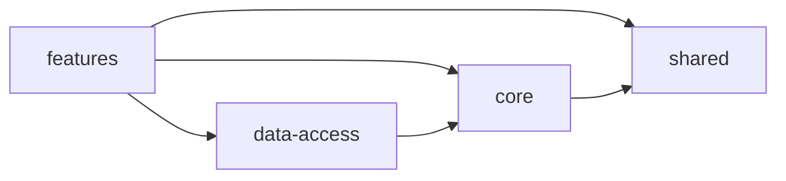

| Layer | Responsibility | Must not |
|---|---|---|
| `core` | HTTP base class, interceptors, auth state, app layout | import from `features` |
| `data-access` | Talk to one API, map DTOs to models | import components or touch the DOM |
| `features` | Pages (smart) and their components (dumb) | call `HttpClient` directly |
| `shared` | Reusable, business-agnostic UI/utilities | import from `features` or `data-access` |

Path aliases (`tsconfig.json`): `@core/*`, `@data-access/*`, `@env/*`, `@shared/*`.

## 4. Routing

```
/            -> redirect /login
/login       -> features/auth/auth.routes      (no shell)
/ (shell)    -> core/layout/app-shell          // canActivate: [authGuard] goes here later
   /home     -> features/map/map.routes        (Weather Stations map)
/**          -> redirect /home
```

The auth guard exists but is intentionally **not** applied, so unauthenticated users are not redirected.

## 5. HTTP access layer

The backend API is described by an `ApiDefinition` in the environment files:

```ts
export interface ApiDefinition {
  readonly baseUrl: string;
  readonly auth?: boolean;                                   // attach Bearer token
  readonly apiKey?: { readonly header: string; readonly value: string }; // public keys only
}
```

Service inheritance (kept to at most three levels):

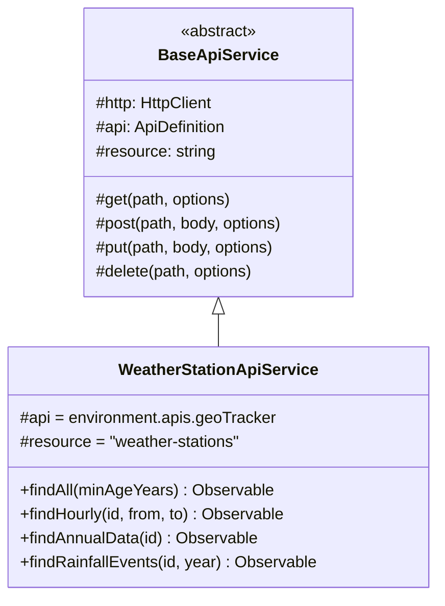

- `BaseApiService` builds `baseUrl/resource/path` and tags every request with the `API_DEFINITION` `HttpContext` token.
- Development and production both use the same-origin `/api` base URL. Angular development proxies `/api` to `http://localhost:8080`; nginx proxies it to the backend in Compose.
- The frontend no longer makes requests to the live INMET API; INMET remains the source of the imported CSV data.
- A generic `CrudApiService` (list/getById/create/update/remove) is **planned but not created yet**.

### Adding a new API

1. Add an entry to `environment.apis` (`baseUrl`, and `auth` / `apiKey` if needed).
2. Create `data-access/<api>/<api>-api.service.ts` — abstract class extending `BaseApiService` that sets `api`.
3. Create the concrete `*.api.ts` (sets `resource`), plus `*.dto.ts`, `*.model.ts`, `*.mapper.ts`.

## 6. Interception layer

Registered in `app.config.ts`:

```ts
provideHttpClient(withFetch(), withInterceptors([apiKeyInterceptor, authInterceptor, errorInterceptor]))
```

| Interceptor | Runs when | Effect |
|---|---|---|
| `apiKeyInterceptor` | Request tagged with an `ApiDefinition` that has `apiKey` | Sets the configured header |
| `authInterceptor` | `ApiDefinition.auth` is true, a token exists, and `SKIP_AUTH` is not set | Sets `Authorization: Bearer <token>` |
| `errorInterceptor` | Every request | Converts errors to `AppError`; on 401 from an `auth` API clears the session (**no redirect yet**) |

Requests that did not go through `BaseApiService` (map tiles, CDNs) have no `API_DEFINITION` and are never modified, so tokens and keys cannot leak to third parties.

### Request workflow — loading weather stations from the database

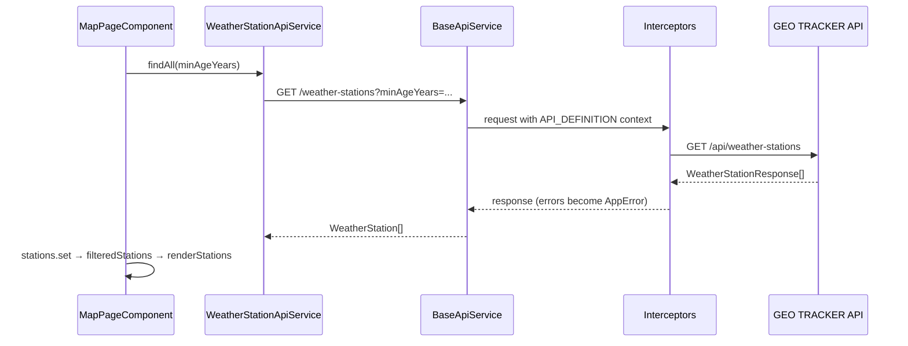

## 7. Authentication workflow (prepared, inactive)

Implemented now: `AuthService` (token signal, `setSession`, `clearSession`), `TokenStorage`, `authInterceptor`, `authGuard`, 401 handling in `errorInterceptor`.
Not implemented yet: backend login endpoint (`AuthApi`), guard on routes, redirect on 401. The login screen currently just navigates to `/home`.

Target workflow once a backend exists:

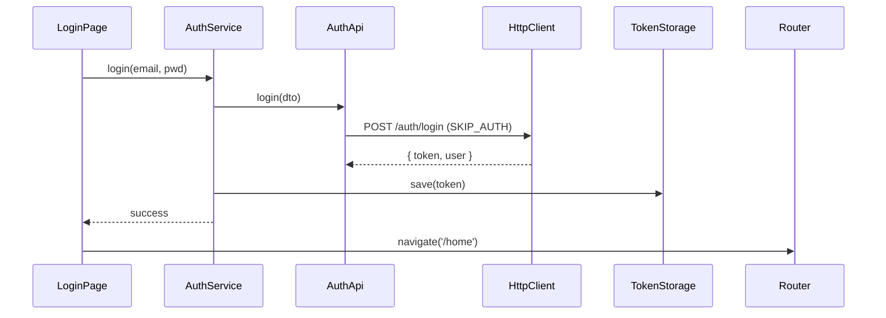

Steps to enable it:

1. Add the backend to `environment.apis` with `auth: true`.
2. Create `data-access/auth/auth.api.ts` extending a backend base service; send the login request with `new HttpContext().set(SKIP_AUTH, true)`.
3. Add `AuthService.login()` that calls `AuthApi` and then `setSession(token)`; call it from the login page.
4. Add `canActivate: [authGuard]` on the shell route in `app.routes.ts`.
5. Add `router.navigate(['/login'])` next to `clearSession()` in `errorInterceptor`.

## 8. GEO TRACKER weather stations

The map reads stations imported into the database; the browser no longer calls INMET directly. `foundedOn` and `detailsAsOf` come from imported station metadata.

| Endpoint | Content |
|---|---|
| `GET /api/weather-stations` | All stations |
| `GET /api/weather-stations?minAgeYears=20` | Stations founded at least 20 years ago; filtered in SQL |
| `GET /api/weather-stations/{id}` | Station header/details for the modal |
| `GET /api/weather-stations/{id}/observations?from={instant}&to={instant}` | Hourly rows in `[from, to)`; maximum range 32 days |
| `GET /api/weather-stations/{id}/annual-data` | Compact annual precipitation/coverage rows; missing years between first and last observation are filled with zeroes |
| `GET /api/weather-stations/{id}/rainfall-events?year=2025` | Events computed on demand with `RUSLE_HOURLY`; no calculation row is persisted |
| `GET /api/weather-stations?state=RS&region=S&q=porto` | Filters, combinable with `minAgeYears`; `q` matches code or name, case-insensitive |
| `GET /api/weather-stations/{id}/coverage` | First and last observation, hours with a rain reading, completeness, years with data; 204 before any import |
| `GET /api/weather-stations/{id}/aggregates?period=month&from=2024-01-01&to=2024-12-31` | Per day, month or year: rain total and wettest hour, temperature, humidity and wind summaries, missing hours |
| `GET /api/variables` | Observation variables: code, column, unit, description, INMET header |
| `GET /api/imports?stationId=1&status=FAILED&page=0&size=50` | Station-file import history, newest first (`items`, `page`, `size`, `total`) |

Observation instants are stored in UTC and shown in local time by Angular. The modal loads station details and the previous month's hourly rows on open, with that month already filled in the shared date range field; picking a complete new range reloads the table (up to 31 days). Annual coverage and yearly events are loaded when those tabs are selected. The map's foundation-date range is client-side; the minimum-age filter is a server query.

## 9. Map page (`/home`)

### Layout

```
┌──────────┬──────────────────────────────────────────────────────────┐
│          │ Topbar (breadcrumbs, live, help, avatar)                 │
│          │ Heading + metrics (active stations, polygons, updated)   │
│ Sidebar  ├───────────────┬──────────────────────────────────────────┤
│ (shell)  │ Map panel     │ Toolbar: Load geofences · Draw polygon   │
│          │ • Polygons    │          · database status               │
│          │ • Stations    ├──────────────────────────────────────────┤
│          │   checkboxes  │ Leaflet map (POIs, polygons, legend)     │
│          │ • Operation   │                                          │
│          │   start range │                                          │
│          ├───────────────┴──────────────────────────────────────────┤
│          │ Status bar                                               │
└──────────┴──────────────────────────────────────────────────────────┘
```

Below 800 px the sidebar collapses to a top bar and the map panel stacks under the map.

### Components

| Component | Type | Inputs / outputs |
|---|---|---|
| `MapPageComponent` | smart | Loads stations and geofences, owns Leaflet and filter state |
| `GeofenceListComponent` | dumb | `geofences`, `selectedId` → `geofenceSelected` |
| `StationLayersComponent` | dumb | station visibility, `minimumAgeYears`, foundation-date range → filter events |
| `StationDetailsDialogComponent` | dialog | station ID → station details, hourly rows, annual summary, rainfall events and the R tab |
| `StationRFactorComponent` | tab | station → R runs: calculate, rerun, chart, years table, exports, previous runs |
| `RFactorPanelComponent` | dumb | cache status, current map → `generate`, `styleChange`, `refreshCache`, `closed` |
| `RFactorLegendComponent` | dumb | class limits and colors of the current R map |

### Points of interest

- Each station is a canvas `L.circleMarker` (fast for hundreds of points).
- Colors: lime = data imported within 90 days, coral = older imported data.
- Hover shows the station name and code. Clicking opens the detail modal with the selected station ID.

### Filters

- **Minimum station age** — `Filter by X years OLD` sends `minAgeYears`; the server filters the station list.
- **Foundation date** — Material date range picker on `foundedOn`. Both ends inclusive, either end optional. Stations without a foundation date are hidden while a range is set. "Clear" removes the range.
- Panel counts, the recent-data metric, database count and status bar reflect the filtered set.

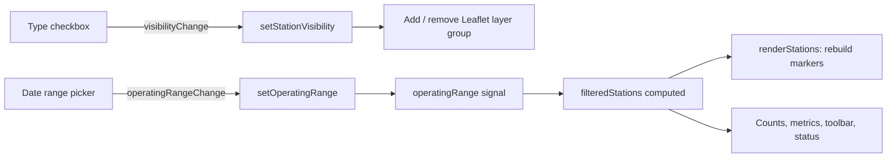

### Toolbar buttons

`R factor map` toggles the R panel (filled while open). `Load geofences` and `Draw polygon`, the polygon metric and the polygon list are hidden while `environment.features.geofences` is `false` (geofences have no backend yet). Buttons use Material's `matButton` with the icon projected through the `matButtonIcon` slot.

### R factor map

The QGIS workflow (station R values → IDW raster → classified colors) inside the map:

1. The panel shows the annual cache status (stations cached, years, stale stations with an `Update` link) and a progress bar while it rebuilds.
2. Settings: period (first and last year), data quality (minimum yearly coverage, minimum valid years — empty = automatic), IDW pixel size (0.25°, 0.1°, 0.05°), power and search radius. `Generate map` calls `GET /api/erosivity-maps` (§12).
3. `RasterGridLayer` (an `L.GridLayer`) paints the returned grid on 256 px canvas tiles, each pixel taking the value of the grid cell under it, in its own pane below the state borders and station markers, so it stays aligned at every zoom.
4. Style changes need no new request: ramp (Spectral, YlOrRd, Viridis, RdYlBu), 5/7/9 quantile or equal-interval classes, opacity, station R labels and IBGE state borders. The legend lists the class limits; hovering the map shows the pixel value.
5. Exports use the same query: `Raster .asc` (ESRI ASCII grid + WGS 84 `.prj`, opens in QGIS and TerrSet), station `GeoJSON` and `CSV`.

The panel collapses to its header, so the map stays usable on small screens.

### Station R tab

The station modal's R tab calculates R for a year range (years with incomplete data are marked `(partial)`) with a preset (`RUSLE_HOURLY`, `RUSLE_HOURLY_I60`, `RS_REGIONAL`) or advanced parameters. It shows R, a bar chart and a table per year, CSV/GeoJSON exports and the station's previous runs. A run whose period received newer imports is flagged `outdated` and can be re-run (same period, same or new parameters).

## 10. Styling

- Component stylesheets are registered **globally** in `angular.json → styles` (the per-component budget is 4 kB warning / 8 kB error). Any new stylesheet must be added there, and `ng serve` must be restarted after editing `angular.json`.
- Theme tokens (`--home-*`) and Material button tokens live on `.tracker-shell` (app shell).
- The datepicker overlay renders outside the shell, so its dark theme targets `.mat-datepicker-content:has(.geo-range-picker)` using `:root` variables. The field itself falls back to literal colors because the station modal also renders outside `.tracker-shell`.
- `src/geo-material.scss` gives Material controls the dark-green look: `.geo-field` (outline form fields, inputs and selects), `.geo-select-panel` (select overlay), `.geo-table` (`mat-table`, opaque sticky header) and a lime-on-dark scrollbar for `.tracker-shell` and `.cdk-overlay-container`. Prefer these Material components over native inputs, selects and tables.
- Dates use the Brazilian dd/mm/yyyy format: `provideBrazilianDates()` (`core/dates/brazilian-date-adapter.ts`) formats and parses datepicker input, and templates use `date: 'dd/MM/yyyy'` (`'dd/MM/yyyy HH:mm'` for hours). Month and weekday labels stay in English.
- Material 22 tab tokens are `--mat-tab-active-*` / `--mat-tab-inactive-*` (not `--mat-tab-header-*`); the station modal sets them to `--lime`.

## 11. Security notes

- Keys in `environment.ts` ship in the browser bundle; only use public or domain-restricted keys. Secrets belong in a backend/proxy.
- Interceptors only act on requests tagged by `BaseApiService`, so credentials are never sent to tile servers or other hosts.
- The token is kept in `sessionStorage`; prefer an httpOnly cookie issued by the backend when it exists.
- All Leaflet popup content is created with `textContent` to prevent XSS.

Backend and containers:

- No user authentication yet. Locally every port is bound to `127.0.0.1`. In the `prod` profile, bulk writes (`POST /api/imports…`, `/api/erosivity-maps/cache/refresh`, `/api/admin/…`) need the `X-Admin-Token` header (`ADMIN_TOKEN`, constant-time comparison, 403 otherwise); reads and R calculations stay public.
- nginx limits each client to 30 writes/min (burst 10) and 60 R map requests/min (burst 20), answering 429. A public instance exposes only Caddy (80/443); PostgreSQL has no published port.
- SQL is always parameterized; table names in `JdbcRepository` are constants, never request input.
- Uploads: single `.csv` up to 20 MB (checked in the service), `.zip` archives up to 512 MB (Spring and the nginx `/api/imports/archives` location; other `/api/` routes keep 10 MB in nginx). Files are not kept: a CSV only leaves its SHA-256, name (client path removed) and parsed rows; an archive waits in a temporary file that is deleted after processing.
- ZIP entries are never extracted to disk (no path traversal); each entry is read into memory only up to its declared size and rejected if the real content differs (zip bomb), and an archive may hold at most 20,000 entries.
- Handled errors return ProblemDetail; unexpected ones use Spring Boot's default body. Neither includes stack traces, and import failure details stay in `station_imports.failure_reason`.
- The `gpstracker` credentials and pgAdmin desktop mode (no login) are for local development only.
- Containers run as non-root users (`app`, `nginx`, `pgadmin`).

## 12. Backend (Kotlin API)

| Concern | Choice |
|---|---|
| Language / runtime | Kotlin 2.3, Java 25 toolchain (downloaded automatically by the foojay resolver if missing) |
| Framework | Spring Boot 4.1 (Spring MVC, Jackson 3) |
| Database | PostgreSQL 18, migrations with Flyway, access with `JdbcClient` / `JdbcTemplate` (no ORM) |
| Build | Gradle 9.7 wrapper, multi-module, versions in `gradle/libs.versions.toml` |
| Base URL | `http://localhost:8080/api` (`server.servlet.context-path`) |

Spring profiles: `dev` is the default and supplies local PostgreSQL defaults (admin endpoints open); Compose explicitly activates `dev`. Activate `prod` with `SPRING_PROFILES_ACTIVE=prod`; `DB_URL`, `DB_USER` and `DB_PASSWORD` are required environment variables with no production defaults, `ADMIN_TOKEN` enables the admin endpoints, `INMET_SYNC_ENABLED=true` turns on the weekly INMET download, and logs are ECS JSON lines.

Operations: Actuator exposes only health (`/api/actuator/health`, with the liveness/readiness groups used by the Compose healthchecks); OpenAPI UI at `/api/docs` (spec `/api/v3/api-docs`); errors are ProblemDetail (RFC 9457) from one `ApiExceptionHandler`.

### Modules

```
backend/
├─ Dockerfile                           # Gradle build stage + JRE 25 runtime, non-root user
├─ settings.gradle.kts                  # modules + JDK toolchain resolver
├─ build.gradle.kts                     # shared Kotlin config (JDK 25, compiler flags)
├─ gradle/libs.versions.toml            # Kotlin, Spring Boot and library versions
├─ domain/                              # pure Kotlin, no dependencies
│  └─ com.gpstracker.domain
│     ├─ shared/       BaseEntity, Coordinate
│     ├─ station/      WeatherStation, StationDetails
│     ├─ observation/  HourlyObservation, PrecipitationHour, ObservationQueries
│     ├─ imports/      StationImport, ImportSummary, ImportStatus, ArchiveImport, ArchiveProgress
│     ├─ erosivity/    ErosivityCalculator (pure engine), RusleParameters (+ presets), ErosivityPeriod,
│     │                ErosivityCalculation, ErosivityResult, StationErosivityYear + PeriodErosivity (map quality rule)
│     └─ raster/       GridSpec, Boundary (scanline mask), IdwInterpolator
├─ application/                         # use cases + ports
│  └─ com.gpstracker.application
│     ├─ shared/       BaseRepository, PageResult
│     ├─ station/      WeatherStationRepository (port), WeatherStationService, WeatherStationDataService
│     ├─ observation/  StationObservationRepository (port; hourly, annual, coverage and aggregate queries)
│     ├─ erosivity/    ErosivityCalculationService + repository port, ErosivityCacheService (annual cache worker),
│     │                ErosivityMapService (IDW maps), ErosivityMapPorts (year cache, refreshes, boundary)
│     └─ imports/      StationImportService, ArchiveImportService, ImportHistoryService, InmetSyncService,
│                      their ports (repositories, file and archive readers, INMET source), ImportFile, exceptions
├─ infrastructure/                      # adapters
│  ├─ com.gpstracker.infrastructure
│  │  ├─ shared/       JdbcRepository, JdbcExtensions
│  │  ├─ station/      JdbcWeatherStationRepository
│  │  ├─ observation/  JdbcStationObservationRepository (set-based upsert with unnest)
│  │  ├─ imports/      JdbcStationImportRepository, JdbcArchiveImportRepository
│  │  ├─ erosivity/    JdbcErosivityCalculationRepository, JdbcErosivityYearCache
│  │  ├─ geo/          GeoJsonBoundaryProvider (resources/geo/br-country.geojson)
│  │  └─ inmet/        InmetCsvReader, ZipStationArchiveReader, InmetHistoricalArchiveClient + sync state
│  └─ resources/db/migration/   V1 stations + observations, V2 erosivity runs, V3 archive imports,
│                               V4 annual erosivity cache, V5 INMET sync state, V6 cache refresh times
└─ api/                                 # Spring Boot executable
   ├─ com.gpstracker.GeoTrackerApplication   # root package, so scanning covers every module
   ├─ com.gpstracker.api.station/    WeatherStationController, ObservationVariableController, responses
   ├─ com.gpstracker.api.imports/    StationImportController, ArchiveImportController, ImportHistoryController,
   │                                InmetSyncController
   ├─ com.gpstracker.api.erosivity/  ErosivityCalculationController, ErosivityMapController, DTOs
   ├─ com.gpstracker.api.shared/     ApiExceptionHandler, AdminTokenFilter, OpenApiConfiguration, Csv
   └─ resources/application.yml, application-dev.yml, application-prod.yml
```

Inside each module, code is grouped by capability (`station`, `observation`, `imports`, `erosivity`, later `auth`); `shared/` holds the base types.

### Dependency rules

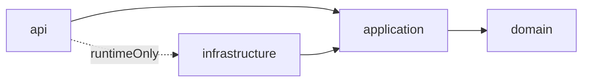

| Module | Responsibility | Must not |
|---|---|---|
| `domain` | Entities, value objects, business invariants | depend on Spring, JPA, HTTP or other modules |
| `application` | Use cases, transactions, ports (repositories, file reader) | know HTTP, SQL or concrete adapters; Spring only for `@Service` / transactions |
| `infrastructure` | Implement ports: PostgreSQL repositories, INMET CSV reader, migrations | contain business rules |
| `api` | HTTP contract: routes, request/response DTOs, validation | contain business rules or import adapters |

`api` depends on `infrastructure` with `runtimeOnly`: Spring finds the adapters at runtime, but importing one from a controller is a compile error.

### Base types

| Type | Module | Role |
|---|---|---|
| `BaseEntity<ID>` | domain | Abstract `id`; equality and hash code by id |
| `BaseRepository<T, ID>` | application | Port: `findAll`, `findById`, `save`, `deleteById` |
| `JdbcRepository<T, ID>` | infrastructure | Implements `findAll` / `findById` / `deleteById` from a table name; subclasses add `mapRow`, `save` and specific queries |

### Request workflow — `GET /api/weather-stations`

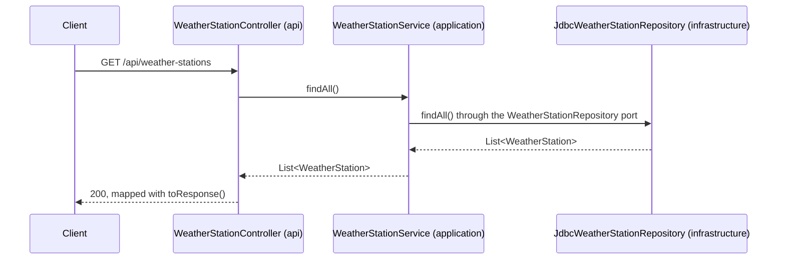

```json
[{ "id": 1, "code": "A801", "name": "PORTO ALEGRE - JARDIM BOTANICO", "region": "S", "state": "RS",
   "latitude": -30.05361111, "longitude": -51.17472221, "altitude": 41.18, "foundedOn": "2000-09-22" }]
```

### Database

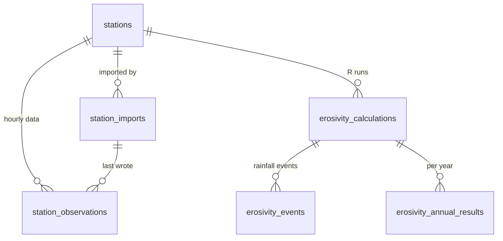

| Table | Holds | Key points |
|---|---|---|
| `stations` | Code, name, region, state, coordinates, altitude, founding date | `code` unique; `details_as_of` = last data hour of the file that supplied the details |
| `station_imports` | One row per CSV (uploaded alone or from an archive): file name, SHA-256, status, station, period, counts, first 100 rejections | A hash can be `COMPLETED` only once (partial unique index) |
| `archive_imports` | One row per uploaded ZIP: status (`QUEUED` → `PROCESSING` → `COMPLETED` / `FAILED`), file counters, rows written, first 100 failed files | Not linked to `station_imports`; each CSV inside keeps its own row there |
| `station_observations` | One row per station and UTC hour, every CSV column translated to English | PK `(station_id, observed_at)`; `NULL` = missing, never zero |
| `erosivity_calculations` | R run: station, period, method + version, parameters (JSONB), status, R, years used | Many per station; a new parameter set is a new run |
| `erosivity_events` | Every rainfall event of a run: start, end, mm, max hourly mm, missing hours, E, I30, EI30, `erosive` | Filled by the calculation, not by the import |
| `erosivity_annual_results` | Per run and year: mm, missing hours, erosive events, sum of EI30, `included` | R = mean of included years |

CSV column → `station_observations` column:

| INMET column | Column |
|---|---|
| `Data` + `Hora UTC` | `observed_at` (TIMESTAMPTZ, UTC, end of the hour) |
| `PRECIPITAÇÃO TOTAL, HORÁRIO (mm)` | `precipitation_mm` |
| `PRESSAO ATMOSFERICA AO NIVEL DA ESTACAO, HORARIA (mB)` | `station_pressure_mb` |
| `PRESSÃO ATMOSFERICA MAX. / MIN. NA HORA ANT. (AUT) (mB)` | `max_pressure_mb` / `min_pressure_mb` |
| `RADIACAO GLOBAL (Kj/m²)` | `global_radiation_kj_m2` |
| `TEMPERATURA DO AR - BULBO SECO, HORARIA (°C)` | `air_temperature_c` |
| `TEMPERATURA DO PONTO DE ORVALHO (°C)` | `dew_point_c` |
| `TEMPERATURA MÁXIMA / MÍNIMA NA HORA ANT. (AUT) (°C)` | `max_air_temperature_c` / `min_air_temperature_c` |
| `TEMPERATURA ORVALHO MAX. / MIN. NA HORA ANT. (AUT) (°C)` | `max_dew_point_c` / `min_dew_point_c` |
| `UMIDADE REL. MAX. / MIN. NA HORA ANT. (AUT) (%)` | `max_relative_humidity_pct` / `min_relative_humidity_pct` |
| `UMIDADE RELATIVA DO AR, HORARIA (%)` | `relative_humidity_pct` |
| `VENTO, DIREÇÃO HORARIA (gr)` / `RAJADA MAXIMA (m/s)` / `VELOCIDADE HORARIA (m/s)` | `wind_direction_deg` / `wind_gust_ms` / `wind_speed_ms` |

Station metadata: `REGIAO` → `region`, `UF` → `state`, `ESTACAO` → `name`, `CODIGO (WMO)` → `code`, `LATITUDE` / `LONGITUDE`, `ALTITUDE` → `altitude_m`, `DATA DE FUNDACAO` → `founded_on`.

### INMET CSV layouts (test fixtures in `infrastructure/src/test/resources/inmet/`)

| | Up to 2018 (2000 sample) | 2019 on (2026 samples) |
|---|---|---|
| Encoding | Latin-1 | Latin-1 |
| Metadata keys | `REGIÃO:`, `ESTAÇÃO:`, `DATA DE FUNDAÇÃO (YYYY-MM-DD):` | `REGIAO:`, `ESTACAO:`, `DATA DE FUNDACAO:` (`dd/MM/yy`) |
| Date and hour | `2000-09-22;00:00` | `2026/01/01;0000 UTC` |
| Missing value | `-9999` | empty |
| Numbers | Decimal comma, sometimes without the zero (`,3`); every line ends with `;` | Same |

`InmetCsvReader` matches columns by name without accents, so both layouts (and a file re-saved as UTF-8) are read the same way.

Quirks found in the yearly ZIPs (2000–2026):

| Quirk | Files | Handling |
|---|---|---|
| Metadata keys with a literal `?` instead of `Ã` (`REGI?O:`, `ESTAC?O:`, `DATA DE FUNDAC?O:`) | All of 2019 | `?` in a key matches any one letter |
| `ALTITUDE:;F` or `ALTITUDE:;NULL` | S-stations 2016–2018, 2 stations in 2026 | Altitude stored as `NULL` |

### Import workflow — `POST /api/imports`

Multipart field `file`, one station CSV per request, up to 20 MB.

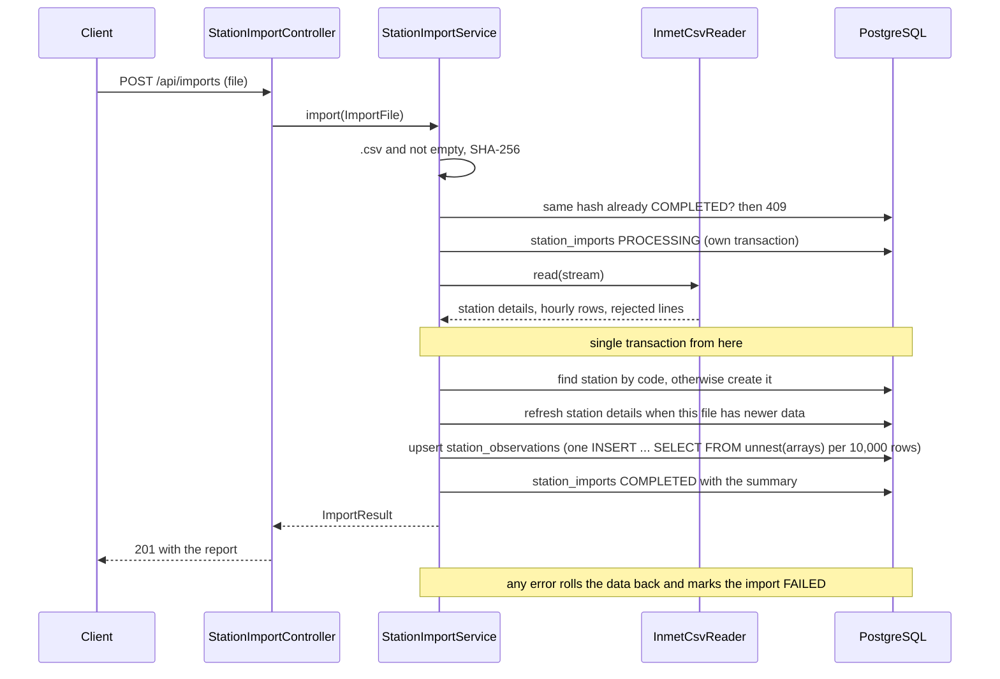

| Rule | Reason |
|---|---|
| Empty and `-9999` values are stored as `NULL` | A missing hour is not a dry hour (B825 has 857 of 6,552 hours without precipitation) |
| Hours are keyed by station and UTC hour; changed values are updated | Re-importing never duplicates |
| A stored hour is not overwritten by a file whose data ends earlier | INMET revises recent hours: A801 `2026-05-04 01:00` changed between the August and September exports |
| Station details are replaced only by a file with newer data | A801 was `PORTO ALEGRE` at -30.05 / -51.17 in 2000 and is `PORTO ALEGRE - JARDIM BOTANICO` today |
| A row with an invalid date, hour or number is rejected; the rest of the file is kept | Report lists the first 100 rejected lines |
| Missing metadata or header: 422 and import `FAILED`; same file again: 409 with the previous import id | |

```json
{ "id": 2, "status": "COMPLETED", "station": { "id": 1, "code": "A801", "name": "PORTO ALEGRE - JARDIM BOTANICO" },
  "periodStart": "2026-01-01T00:00:00Z", "periodEnd": "2026-09-30T23:00:00Z",
  "rowsRead": 6552, "rowsWritten": 721, "rowsSkipped": 5831, "rowsRejected": 0,
  "missingPrecipitationRows": 95, "rejections": [] }
```

### Bulk import — `POST /api/imports/archives`

Multipart field `file`: one INMET yearly ZIP (`<year>.zip` from the INMET historical data page, up to 512 MB), with one CSV per station at the root (2020 on) or inside a `<year>/` folder (up to 2019).

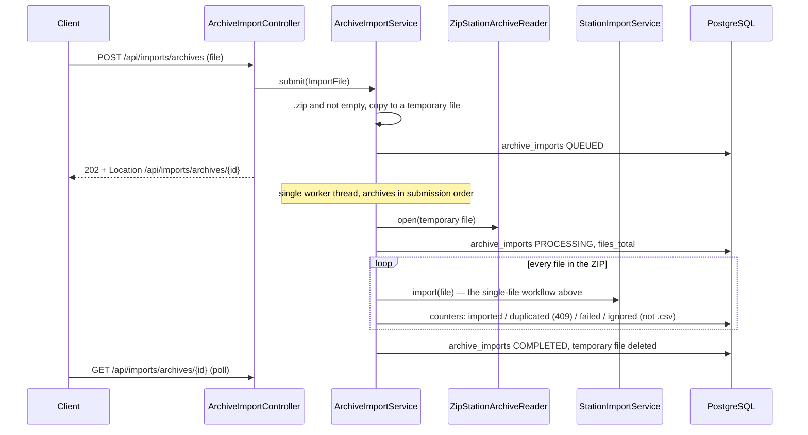

| Rule | Reason |
|---|---|
| Each CSV reuses `StationImportService` (own `station_imports` row and transaction) | Hash, duplicate, revision and station-details rules stay in one place; a bad file fails alone |
| The request returns `202` and the archive is processed in the background | A 2026 ZIP has 1,276 files and takes minutes |
| One worker thread, archives in order | Two archives in parallel would race to create the same station |
| An already imported CSV counts as `duplicated` | Re-uploading an archive only adds new or changed files |
| Archives left `QUEUED` / `PROCESSING` by a restart are marked `FAILED` on startup | The temporary file is lost; upload the archive again (completed CSVs are skipped as duplicates) |
| The 2026 ZIP has two exports per station (to 31 Aug and to 30 Sep) | Both are imported; the revision rule keeps the September values for overlapping hours, in any order |

```json
{ "id": 2, "fileName": "2007.zip", "status": "COMPLETED", "filesTotal": 264, "filesProcessed": 264,
  "filesImported": 264, "filesDuplicated": 0, "filesFailed": 0, "filesIgnored": 0, "rowsWritten": 2312640,
  "failures": [], "failureReason": null }
```

Throughput on the local stack is about 11,000 rows/s (≈ 0.6 s per station-year): most of the time is the per-row foreign-key checks on `station_observations` (`station_id`, `import_id`), kept for integrity. The 27 INMET ZIPs (2000–2026) hold about 11,400 station-year files.

### R factor — research and decisions

R is the mean, over the years, of the annual sum of EI30 of the erosive rainfall events. Steps:

| # | Step | RUSLE (Renard et al. 1997) | Rio Grande do Sul studies |
|---|---|---|---|
| 1 | Series | Station precipitation in order, UTC, `NULL` = missing | Same |
| 2 | Split events | Event ends after 6 h with less than 1.27 mm | 6 h with less than 1.0 mm |
| 3 | Erosive event | ≥ 12.7 mm, or ≥ 6.35 mm in 15 min | ≥ 10 mm, or ≥ 6 mm in 15 min |
| 4 | Unit energy per interval | $e = 0.29[1 - 0.72e^{-0.05i}]$ (Brown & Foster) | $e = 0.119 + 0.0873\log_{10} i$ (Wischmeier & Smith) |
| 5 | Event energy | $E = \sum e_r v_r$ (MJ/ha) | Same |
| 6 | I30 | Maximum 30-minute intensity (mm/h) | Same |
| 7 | Event erosivity | $EI_{30} = E \cdot I_{30}$ | Same |
| 8 | R | Mean of annual sums, at least 20 years | 20 to 30 years |

Limits of INMET hourly data: the 15-minute criterion cannot be tested and I30 cannot be measured (only the maximum hourly amount, I60), so the I30 estimate (calibration factor or regression on I60) is a calculation parameter.

Decisions:

- The import stores only facts: hourly precipitation with `NULL` for gaps, UTC hours, the newest revision of each hour, and the missing-precipitation count per file.
- Events and their `erosive` flag are produced by a calculation run (`erosivity_events`, linked to the station through `erosivity_calculations`), not during the import, because the criteria above differ between methods, events cross the yearly file boundary (31 Dec → 1 Jan), and INMET revises recent hours.
- Recomputing is cheap: 26 years of one station are about 228,000 hourly rows.

### R factor — method `RUSLE_HOURLY` v1

Decided with the project owner (2026-10-08):

| Topic | Decision | Implementation |
|---|---|---|
| Storm rules | Standard RUSLE | New event after 6 h with < 1.27 mm (rainy hours inside that gap start the next event); erosive when the event total is ≥ 12.7 mm. The 15-minute test is not applied (hourly data). |
| Energy | Wischmeier & Smith | $e = 0.119 + 0.0873\log_{10} i$ (MJ ha⁻¹ mm⁻¹), $e = 0.283$ above 76 mm/h; the hour's depth is its intensity; $E = \sum e \cdot v$ |
| I30 | Adapted to hourly data | $I_{30} \approx I_{60} \times$ `i30Factor`, where $I_{60}$ is the wettest hour of the event. Default factor **1.7** ($2 \times 0.85$, the hourly-data adjustment for southern Brazil used by the earlier Python pipeline); Panagos et al. 2016 (*Water* 8:119) report 60 → 30 min factors of 1.54 to 2.13 in Europe. Runs before 2026-10-10 used 1.0. |
| Result | Yearly | Annual erosivity = sum of $EI_{30}$ of erosive events per year; R = mean of the annual values of the period. At least 10 years is ideal; shorter and recent periods are allowed. |
| Year boundary | UTC | A year holds the readings timestamped in it (as INMET's annual files); an event belongs to the year of its first reading. The front end converts times to local time. |
| Missing data | No coverage rule | Missing hours count as dry; every year with at least one reading is included. Each year reports its missing hours, so partial years are visible. |
| Reference result | Python pipeline (`docs/python_calc`) | Compared on 2026-10-10 (below); `i30Factor` is stored per run, so old runs stay reproducible. |

Every run is a new row in `erosivity_calculations` with a JSONB snapshot of the parameters; results are never overwritten.

| Endpoint | Does |
|---|---|
| `POST /api/erosivity-calculations` | Body `{ "stationCode": "A801", "periodStart": "2000-01-01", "periodEnd": "2026-12-31" }` (UTC dates, inclusive), optionally `"preset"` or `"parameters"` overrides. Calculates synchronously and returns 201 with R and the years |
| `GET /api/erosivity-calculations/{id}` | Stored run with its years |
| `GET /api/erosivity-calculations/{id}/events` | Every rainfall event of the run (start, end, mm, I60, E, I30, EI30, `erosive`) |
| `GET /api/erosivity-calculations?stationId=1` | Runs of a station, newest first, each with `outdated` (an import touching the run's period completed after the run) |
| `GET /api/erosivity-calculations/presets` | Named parameter sets: `RUSLE_HOURLY` (default), `RUSLE_HOURLY_I60` (factor 1.0), `RS_REGIONAL` (1.0 mm split, ≥ 10 mm erosive) |
| `POST /api/erosivity-calculations/{id}/rerun` | New run for the same station and period; optional body `{ "preset": "RS_REGIONAL" }` or `{ "parameters": { … } }` |
| `GET /api/erosivity-calculations/{id}/annual.csv`, `/events.csv`, `/station.geojson` | Downloads for spreadsheets, QGIS and TerrSet |

Errors: unknown station or run 404, invalid period 400, no precipitation in the period 422.

```json
{ "id": 8, "station": { "id": 1, "code": "A801", "name": "PORTO ALEGRE - JARDIM BOTANICO" },
  "periodStart": "2001-01-01", "periodEnd": "2006-12-31", "method": "RUSLE_HOURLY", "methodVersion": 1,
  "parameters": { "separationHours": 6, "separationMaxMm": 1.27, "erosiveMinMm": 12.7,
                  "energyEquation": "WISCHMEIER_SMITH_1978", "i30Estimate": "I60_X_FACTOR", "i30Factor": 1.7, "yearBoundary": "UTC" },
  "rFactor": 3386.7, "unit": "MJ mm ha-1 h-1 yr-1", "yearsUsed": 6,
  "years": [ { "year": 2001, "erosivity": 4444.3, "erosiveEvents": 35, "precipitationMm": 1328.4, "missingHours": 1106, "included": true },
             { "year": 2002, "erosivity": 3693.3, "erosiveEvents": 40, "precipitationMm": 1395.2, "missingHours": 1197, "included": true } ] }
```

Verified against the samples: the three largest A801 events recomputed from raw hours in SQL give the same mm, I60, E and EI30, with < 1.27 mm in the 6 h before and after each event, and every annual value equals the sum of its erosive events.

#### Comparison with the Python pipeline (`docs/python_calc`, 2026-10-10)

Same A801 hours (2000–2006) run through the original Python code and through a Python copy of `RUSLE_HOURLY`, changing one rule at a time:

| Rule | Python pipeline | API | Effect on API R (full years 2001–2006, 1992 with factor 1.0) |
|---|---|---|---|
| I30 | $I_{60} \times 1.7$ | $I_{60} \times 1.0$ | **+70% — the cause of the ~2k vs ~4k gap; API changed to 1.7** |
| Erosive event | ≥ 10 mm or an hour ≥ 6 mm (regional criteria) | ≥ 12.7 mm (RUSLE) | Python's rule would add +5% |
| Event split | Only after > 6 fully dry hours | 6 h with < 1.27 mm (RUSLE) | Python's rule would add +6% |
| Unit energy | $0.1194 + 0.0574\log_{10} i$ | $0.119 + 0.0873\log_{10} i$ | Python's slope gives −13%; it reaches only 0.2274 at 76 mm/h instead of meeting the 0.2833 cap, so the API keeps 0.0873 |
| Year boundary | Local time (UTC−3) | UTC | No change |

R for 2001–2006: API with factor 1.7 = **3386.7**; Python pipeline = 3217.7; Python rules with the correct energy slope = 3693.8. Including the partial year 2000 (Sep–Dec) lowers the API value to 3078.2, so use full years.

Sources: Renard et al. 1997 (USDA Agriculture Handbook 703); Panagos et al. 2017, *Sci. Rep.* 7:4175; Yin et al. 2015, *HESS* 19:4113; Mazurana et al. 2009, *RBEAA* 13:975 (Santa Rosa, RS); Eltz et al. 2013, *RBEAA* 17:647 (São Gabriel, RS); Trindade et al. 2016, *Pesq. Agropec. Bras.* 51(12) (Brazil map).

#### Validation against published values (2026-10-31)

Default parameters, 2001–2025, years with at least 80% of hours read (`GET /api/erosivity-maps/stations.csv?fromYear=2001&toYear=2025`):

| Reference | Published (MJ mm ha⁻¹ h⁻¹ yr⁻¹) | GEO TRACKER |
|---|---|---|
| Brazil review — Oliveira, Wendland & Nearing 2013, *Catena* 100:139 | 1,672 to 22,452; lowest in the Northeast, highest in the North, rising east → west | 528 stations: 862 to 20,286 (map 911 to 20,174, mean 8,980); semi-arid Northeast lowest, Amazon highest |
| Rio Grande do Sul, 1991–2020 normals — *RBRH* 29 (2024) | 3,500 to 12,500, rising east → west | 44 RS stations: 4,013 (São José dos Ausentes) to 10,267 (Santiago); coast 4,200–6,500, west 7,300–10,300 |
| São Borja — Cassol et al. 2008, *RBCS* 32:1239 (pluviographs 1956–2003) | 9,751 | A830: 7,352 (12 years), 25% lower |
| Quaraí — Bazzano et al. 2007, *RBCS* 31:1205 (pluviographs 1966–2003) | 9,292 | A831: 7,490 (16 years), 19% lower |
| Porto Alegre — ESDAC global erosivity | ~4,000 | A801: 4,179 (2001–2015), 4,821 (2001–2025) |

Ranges and spatial gradients agree. At the two western stations R is about 20% below the pluviograph studies: different decades, and hourly totals still smooth short bursts even with `i30Factor` 1.7. Where local pluviograph results exist, `i30Factor` can be calibrated in the advanced parameters; each run stores its own parameters.

### R map — national raster (`/api/erosivity-maps`)

Paints Brazil with R for any year range the way a QGIS user would (station points → IDW → raster), without recalculating 700 stations per request.

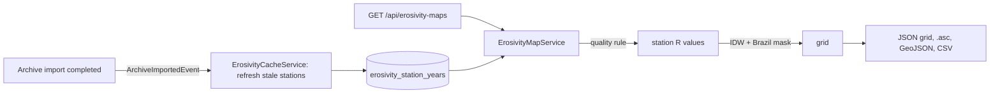

| Step | Rule |
|---|---|
| Annual cache (V4) | One row per station and UTC year for the default parameters (key `RUSLE_HOURLY:v1:6:1.27:12.7:1.7`): hours in the year, hours with a rain reading, mm, erosive events, ΣEI30. Other parameter sets use per-station runs. |
| Freshness (V6) | `erosivity_station_refreshes` records when each station was computed, even when it has no rain data. A station is stale if never computed or if one of its imports completed after that time; the time is taken before reading, so an import landing during a refresh leaves the station stale. |
| Refresh | One worker thread. Runs after every archive import (stale stations only) or on `POST /api/erosivity-maps/cache/refresh?onlyStale=true` (admin); progress in `GET /api/erosivity-maps/cache` and `/cache/refreshes/{id}`; a refresh interrupted by a restart is marked `FAILED`. |
| Quality | A year counts when its coverage (hours with a rain reading ÷ hours in the year) ≥ `minCoverage` (default 0.8). A station needs `minYears` valid years (default min(5, ⌈years ÷ 2⌉)). Station R = mean ΣEI30 of its valid years. |
| Interpolation | IDW (Shepard, as in QGIS): `power` 2, the `maxNeighbors` 12 nearest stations within `maxDistanceKm` 400 (km on a local equirectangular projection). Cells with no station in range stay empty. |
| Grid | EPSG:4326, `cellSize` 0.1° by default (0.05–1°), covering mainland Brazil and snapped to whole cells, row 0 at the north edge. Cells outside Brazil (IBGE outline, even-odd scanline fill) are `null`. |
| Memory | The last 8 maps are kept and dropped whenever the cache changes. |
| Exports | `/grid.zip` = ESRI ASCII grid (`.asc`, `NODATA_value -9999`) + WGS 84 `.prj`; `/stations.geojson` and `/stations.csv` = the station values behind the grid. Same query parameters as the map. |

### INMET sync (`/api/admin/inmet-sync`)

`InmetSyncService` downloads `https://portal.inmet.gov.br/uploads/dadoshistoricos/<year>.zip` inside the backend and queues it like an uploaded archive, so a public instance stays current without manual uploads.

| Rule | Detail |
|---|---|
| Schedule | Mondays 04:00 UTC (`geo.inmet-sync.cron`) when `INMET_SYNC_ENABLED=true`: the current year, plus the previous one from January to March |
| Conditional download | `If-Modified-Since` / `If-None-Match` from `inmet_sync_state` (V5); an unchanged year is not downloaded again |
| Manual | `POST /api/admin/inmet-sync?year=2024` (without `year`: the scheduled years); `GET` lists the stored state. Admin token in `prod` |
| Result per year | `QUEUED` with the archive import id, `NOT_MODIFIED` or `NOT_FOUND` |

### API contract and tests

- springdoc publishes `/api/v3/api-docs`. The Angular models are aliases of the generated schemas (`data-access/api/openapi.d.ts`, regenerated with `npm run api:types` while the API runs), so a renamed DTO field breaks the frontend build instead of failing at runtime.
- springdoc reads Kotlin DTOs through Jackson 2: properties such as `rFactor` need `@get:JsonProperty("rFactor")`, otherwise the spec says `rfactor` while the API sends `rFactor`. `OpenApiContractIntegrationTest` checks the spec against real responses.
- `./gradlew build` runs the domain tests (`ErosivityCalculatorTest`, `RasterTest`), the INMET reader against fixtures of every CSV layout quirk, and Testcontainers integration tests on PostgreSQL 18 (import and queries, admin token, OpenAPI contract, erosivity cache). Without Docker the integration tests are skipped, so CI fails when any test is skipped.

### Containers

| Service | Built from | Host port | Notes |
|---|---|---|---|
| `db` | `postgres:18-alpine` | `127.0.0.1:5432` | Volume `db-data` on `/var/lib/postgresql` (PostgreSQL 18 layout); healthcheck with `pg_isready`; `synchronous_commit=off` and `max_wal_size=4GB` for bulk loads (a crash can lose the last commits, never half a file) |
| `backend` | `backend/Dockerfile` (Temurin 25 JRE, user `app`) | `127.0.0.1:8080` | `DB_URL`, `DB_USER`, `DB_PASSWORD`; starts after `db` is healthy; Flyway migrates on start |
| `frontend` | `frontend/Dockerfile` (Node 24 build, nginx-unprivileged) | `127.0.0.1:4200` | Serves Angular with SPA fallback; proxies `/api/` to `backend` (same origin, no CORS), resolving `backend` per request so a rebuilt backend is found without restarting nginx |
| `pgadmin` | `dpage/pgadmin4:9.18` | `127.0.0.1:5050` | Desktop mode (no pgAdmin login); server "GEO TRACKER" and its pgpass are generated from `DB_*` and imported on first start (volume `pgadmin-data`) |

Credentials are development defaults (`gpstracker`) in `docker-compose.yml` and `application.yml`; override them with a `.env` file next to `docker-compose.yml` (`DB_NAME`, `DB_USER`, `DB_PASSWORD`). After changing them, recreate pgAdmin's volume so it imports the new values: `podman compose rm -sf pgadmin` and `podman volume rm gps-tracker_pgadmin-data`.

The public deployment (`deploy/docker-compose.prod.yml`) runs the same images from GHCR behind Caddy, without pgAdmin or published database ports (see §14).

### Adding a backend feature

1. `domain/<feature>/`: entity extending `BaseEntity`, plus value objects.
2. `application/<feature>/`: repository port extending `BaseRepository`, and the service.
3. `infrastructure/<feature>/`: adapter implementing the port (extend `JdbcRepository` for tables).
4. `api/<feature>/`: controller and request/response DTOs with `toResponse()` mappers.
5. Schema changes: a new `V<n>__description.sql` in `infrastructure/src/main/resources/db/migration` (never edit an applied one).

## 13. Commands

```bash
# whole stack with Podman: `podman machine start` first; compose provider: `winget install Docker.DockerCompose`
# (with Docker Desktop, use `docker compose` in place of `podman compose`)
podman compose up --build -d     # app http://localhost:4200, API http://localhost:8080/api, pgAdmin http://localhost:5050
podman compose up -d db          # only PostgreSQL, to run the backend with Gradle
podman compose logs -f backend   # follow the API log
podman compose down              # stop (add -v to delete the database volume)

# frontend/
npm start                  # ng serve on http://localhost:4200
npx ng build               # production build (checks budgets)
npx ng test --watch=false  # unit tests

# backend/ (gradlew.bat on Windows; needs the db service running)
./gradlew build            # compile every module
./gradlew :api:bootRun     # API on http://localhost:8080/api
# VS Code: Tasks: Run Task → backend: build / backend: run

# import one INMET file
curl -F "file=@docs/<INMET file>.CSV" http://localhost:8080/api/imports

# import INMET yearly ZIPs (queued, processed one at a time) and follow one
curl -F "file=@docs/inmet-files/2024.zip" http://localhost:8080/api/imports/archives
curl http://localhost:8080/api/imports/archives/1
# PowerShell, every ZIP in order:
# Get-ChildItem docs\inmet-files\*.zip | Sort-Object Name | % { curl.exe -s -F "file=@$($_.FullName)" http://localhost:8080/api/imports/archives }

# start from an empty database (deletes only the PostgreSQL volume)
podman compose rm -sf db; podman volume rm gps-tracker_db-data; podman compose up -d

# calculate R (UTC dates, inclusive)
curl -H "Content-Type: application/json" -d '{"stationCode":"A801","periodStart":"2001-01-01","periodEnd":"2025-12-31"}' http://localhost:8080/api/erosivity-calculations

# R map 2001–2025: JSON grid, and the raster for QGIS / TerrSet
curl "http://localhost:8080/api/erosivity-maps?fromYear=2001&toYear=2025" -o r-map.json
curl "http://localhost:8080/api/erosivity-maps/grid.zip?fromYear=2001&toYear=2025" -o r-2001-2025.zip
# rebuild stale annual cache entries (open in dev; X-Admin-Token header in prod)
curl -X POST "http://localhost:8080/api/erosivity-maps/cache/refresh?onlyStale=true"

# frontend/: regenerate API types after changing backend DTOs (API running on :8080)
npm run api:types
```

## 14. Publishing (free)

| Piece | Free option | In the repository |
|---|---|---|
| Source and CI | Public GitHub repository [gabrielmandel/geo-tracker](https://github.com/gabrielmandel/geo-tracker), MIT license (Actions is free for public repositories) | `.github/workflows/ci.yml`: backend build with every test (Testcontainers uses the runner's Docker; the job fails if a test was skipped), frontend build and tests |
| Images | GitHub Container Registry, free for public images | `.github/workflows/publish.yml`: `ghcr.io/gabrielmandel/geo-tracker-backend` and `-frontend` for `linux/amd64` and `linux/arm64`; tags `edge` (main), `1.2.3` / `1.2` / `latest` (git tag `v1.2.3`) and `sha-…`; pull requests only build |
| Server | Oracle Cloud Always Free: Ampere A1 (arm64), 2 OCPU / 12 GB, 200 GB block storage, 10 TB/month egress | `deploy/docker-compose.prod.yml` (sized for that VM) |
| HTTPS | Caddy with Let's Encrypt; free host name from DuckDNS (`name.duckdns.org`) or `<ip-with-dashes>.sslip.io` | `deploy/caddy/Caddyfile` |
| Data | INMET downloads inside the backend | `deploy/seed-inmet.sh` (first load), weekly `INMET_SYNC_ENABLED` |
| Backups | Daily `pg_dump` (custom format) kept 3 days in `deploy/backups/`; Oracle also allows 5 free volume backups | `backup` service in the prod compose |

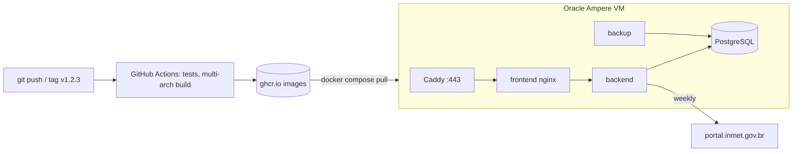

Steps:

1. Push to `main` of [gabrielmandel/geo-tracker](https://github.com/gabrielmandel/geo-tracker): CI runs and `publish.yml` creates the two packages. Once, make each package **public** (your profile → Packages → package → Package settings → Danger Zone → Change visibility): new packages start private even in a public repository, so the server could not pull them anonymously. Public cannot be undone.
2. Create the VM: `VM.Standard.A1.Flex`, 2 OCPU / 12 GB, Ubuntu 24.04, boot volume ~100 GB (the full INMET history is about 14 GB in PostgreSQL, 89 million hourly rows, plus WAL, dumps and images). Allow TCP 80/443 and UDP 443 in the subnet security list and in the VM firewall (Oracle's Ubuntu images only accept SSH by default).
3. Point the host name to the VM's public IP.
4. On the VM: install Docker Engine with the Compose plugin; copy `deploy/`; `cp .env.example .env` and fill `DOMAIN`, `ACME_EMAIL`, `GHCR_OWNER`, `DB_PASSWORD`, `ADMIN_TOKEN` (`openssl rand -hex 32`).
5. `docker compose -f docker-compose.prod.yml up -d` — Caddy obtains the certificate on first start.
6. `sh seed-inmet.sh` — queues 2000 → current year from INMET; imports run one at a time (hours for the whole history) and the R cache follows each year. Progress: `docker compose -f docker-compose.prod.yml logs -f backend`.
7. Updates: push a `vX.Y.Z` tag, then `docker compose -f docker-compose.prod.yml pull && docker compose -f docker-compose.prod.yml up -d`.

Notes: Oracle may reclaim Always Free instances that stay idle (CPU, network and memory all under 20%) for 7 days. The admin token is a stop-gap until JWT (§15): the seed script reads it inside the container, so it never appears on the command line; rotate it by editing `.env` and running `up -d`. The prod stack was smoke-tested locally from an empty database: migrations, admin-token checks, INMET seeding of 2000–2001 and an R map through Caddy.

## 15. Next steps

Done: dev/prod profiles; station map, filters and modal; query API (filters, coverage, aggregates, variables, import history); R runs with presets, rerun, outdated flag and exports; national R map with annual cache and QGIS exports; weekly INMET sync; ProblemDetail, health and OpenAPI; generated frontend types; Testcontainers tests; CI and free publishing; MIT license. All 27 INMET ZIPs (2000–2026, 704 stations) are imported locally; A801 2001–2025: **R = 4,821**.

1. **Authentication (JWT)** — login, refresh/logout, roles for imports and calculations, ownership of runs; replaces `X-Admin-Token`. Decide private vs shared calculations and the token strategy first.
2. **Calibration** — compare more stations with pluviograph studies and decide whether `i30Factor` should vary by region.
3. **Later** — geofence persistence (UI hidden until then), more variables and methods, monthly R maps, partitioning or TimescaleDB if volume grows, Brazilian number format (1.234,5) if wanted.
